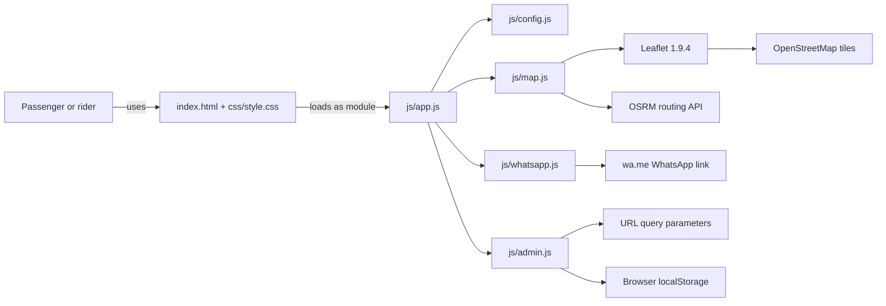
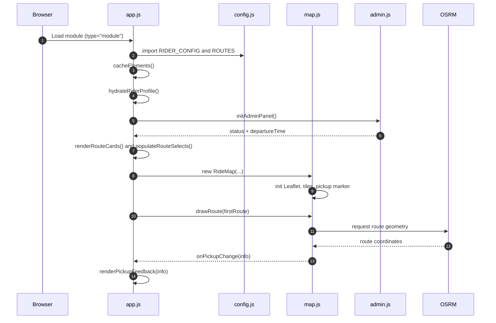
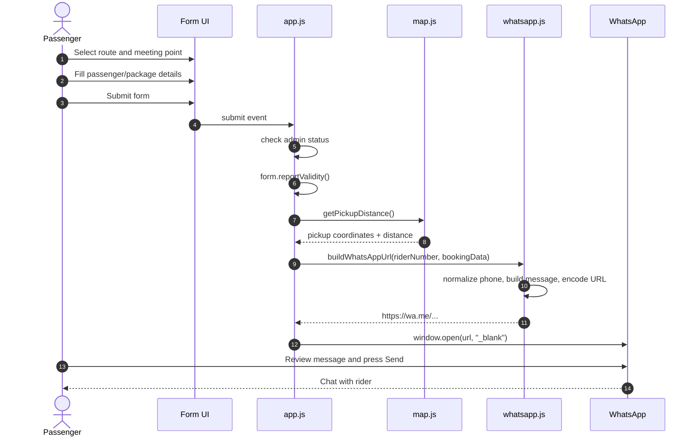

# How Nebeng Motor Searah Works

A technical and product guide to the architecture, modules, data flow, user
interactions, and booking lifecycle of **Nebeng Motor Searah**.

The application is a static, mobile-first website for a daily motorcycle
ride-sharing service between Meruya Selatan, West Jakarta, and the Sudirman
business district. It supports two services:

- **Motorcycle Ride Sharing** (boncengan motor)
- **Same-Direction Package Delivery** (titip paket searah)

There is no backend, database, payment gateway, or user account system. The
website collects a booking, validates it in the browser, and hands the passenger
off to a pre-filled WhatsApp chat with the rider. The rider confirms the booking
manually in WhatsApp.

---

## Contents

1. [Architecture at a glance](#1-architecture-at-a-glance)
2. [Repository layout](#2-repository-layout)
3. [Modules and responsibilities](#3-modules-and-responsibilities)
4. [Data model and application state](#4-data-model-and-application-state)
5. [Runtime data flow](#5-runtime-data-flow)
6. [Key features](#6-key-features)
7. [User interactions and journeys](#7-user-interactions-and-journeys)
8. [Booking process from start to finish](#8-booking-process-from-start-to-finish)
9. [Admin and availability flow](#9-admin-and-availability-flow)
10. [Validation, fallbacks, and error handling](#10-validation-fallbacks-and-error-handling)
11. [Configuration and extension guide](#11-configuration-and-extension-guide)
12. [Privacy, security, and limitations](#12-privacy-security-and-limitations)
13. [Running and deploying](#13-running-and-deploying)
14. [Glossary](#14-glossary)
15. [Related documents](#15-related-documents)

---

## 1. Architecture at a glance

### 1.1 Design principles

The application follows a small, deliberate set of principles:

- **Separation of concerns.** Rider data, map behaviour, WhatsApp messaging,
  admin state, and DOM orchestration live in separate modules.
- **Configuration over hard-coding.** Rider details and daily routes come from
  `js/config.js`; the UI is populated from that data.
- **Vanilla JavaScript, no build step.** The site uses native ES modules
  (`<script type="module">`), so it can be hosted directly on GitHub Pages.
- **Explicit rendering.** There is no reactive framework. `js/app.js` owns the
  application state and calls render functions after state changes.
- **Progressive resilience.** The page has a `<noscript>` message, the map falls
  back to a straight line when OSRM is unavailable, and WhatsApp checkout has a
  manual fallback link when a popup is blocked.
- **Mobile-first and accessible.** The layout, map sizing, controls, tabs, and
  feedback are designed for small screens first, with semantic HTML, labels,
  ARIA roles, focus styles, and reduced-motion support.

### 1.2 Runtime topology



`js/app.js` is the **composition root**: it imports the other modules and wires
them to the DOM. The other modules do not import each other, which keeps the
dependency graph acyclic and each module independently understandable.

### 1.3 Technology stack

| Layer | Technology | Role |
| --- | --- | --- |
| Markup | Semantic HTML5 | Page structure, forms, sections, accessible landmarks |
| Styling | Tailwind CSS CDN + `css/style.css` | Utility layout plus custom component styles |
| Icons | Font Awesome 6.5.2 CDN | Motorcycle, WhatsApp, helmet, box, location icons |
| Fonts | Google Fonts, Plus Jakarta Sans | Brand typography |
| Map | Leaflet 1.9.4 + OpenStreetMap tiles | Interactive route and pickup map |
| Routing | Public OSRM demo API | Road geometry and route distance/duration |
| Application | Native JavaScript ES6 modules | State, rendering, events, validation |
| Checkout | WhatsApp `wa.me` links | Pre-filled booking message to the rider |
| Persistence | URL query parameters + `localStorage` | Admin status and departure-time overrides |
| Hosting | GitHub Pages | Static hosting with no server runtime |

### 1.4 Architectural boundaries

| Boundary | Responsibility | Does not do |
| --- | --- | --- |
| `index.html` | Document structure, form fields, CDN loading, mount points | Business logic or data ownership |
| `css/style.css` | Custom presentation, responsive map, states, accessibility | Data or behaviour |
| `js/config.js` | Rider and route source of truth | DOM access or network calls |
| `js/app.js` | Orchestration, state, rendering, validation, checkout handoff | Leaflet internals or message formatting details |
| `js/map.js` | Leaflet map, OSRM routing, markers, pickup distance | Form validation or WhatsApp messages |
| `js/whatsapp.js` | Phone normalization, message construction, URL encoding | DOM access or storage |
| `js/admin.js` | Admin panel, URL/localStorage state, share links | Rendering route cards or map routes |

---

## 2. Repository layout

```text
.
├── index.html              # Single-page UI and form markup
├── css/
│   └── style.css           # Custom responsive and component styles
├── js/
│   ├── app.js              # Application entry point and orchestrator
│   ├── config.js           # RIDER_CONFIG and ROUTES
│   ├── map.js              # RideMap controller and distance helpers
│   ├── whatsapp.js         # Booking message and wa.me URL builders
│   └── admin.js            # AdminPanel controller and URL/localStorage state
├── ARCHITECTURE.md         # This document
├── CHANGELOG.md            # Development phases and notable changes
└── README.md               # Short project description
```

All application paths are relative, so the site works from a GitHub Pages
project path such as `https://username.github.io/Nebeng-Motor-Searah/`.

---

## 3. Modules and responsibilities

### 3.1 `js/config.js` — rider and route data

`config.js` is the single source of truth for the rider and the daily schedules.
It contains no DOM code, network calls, or side effects.

#### `RIDER_CONFIG`

| Field | Current value | Used for |
| --- | --- | --- |
| `name` | `Rizky Pratama` | Rider card, WhatsApp greeting, admin status message |
| `whatsappNumber` | `62895332782122` | Header/footer chat links and checkout destination |
| `motorcycle.type` | `Honda Vario 160` | Rider card |
| `motorcycle.color` | `Hitam Doff` | Rider card |
| `licensePlate` | `B 41•• KQ` | Rider card; partially masked |
| `spareHelmet` | `true` | Rider card and helmet-option availability |
| `maxDetourKm` | `5` | Map detour circle, badge threshold, rider card, help text |
| `homeBase` | `Meruya Selatan, Jakarta Barat` | Available for future use; not currently rendered |
| `operatingDays` | Monday–Friday | Available for future use; not currently rendered |

#### `ROUTES`

`ROUTES` is an array of route objects. Each route has this shape:

```js
{
  id: 'morning-meruya-sudirman',
  period: 'morning',                  // 'morning' or 'evening'
  name: 'Pagi · Meruya Selatan → Sudirman',
  departureTime: '06:15',             // default 24-hour time
  baseContribution: 12000,            // suggested fuel contribution in IDR
  startPoint: { name, lat, lng },
  endPoint: { name, lat, lng },
  waypoints: [                        // meeting points in travel order
    { name, lat, lng },
    // ...
  ],
}
```

The current sample data contains:

| Route | Period | Default time | Contribution | Meeting points |
| --- | --- | --- | --- | --- |
| `morning-meruya-sudirman` | Morning | `06:15` | Rp 12.000 | 5 |
| `evening-sudirman-meruya` | Evening | `17:30` | Rp 12.000 | 5 |

The morning route runs from Meruya Selatan to SCBD/Sudirman. The evening route
runs in reverse. The sample waypoints include Meruya Ilir, Kebon Jeruk, Tanjung
Duren, Slipi, and Semanggi.

`baseContribution` is a **suggested fuel contribution**, not a commercial fare.
The UI labels it as “Kontribusi” and “Kontribusi bensin.”

### 3.2 `js/app.js` — application orchestrator

`app.js` is the only module loaded directly by `index.html`. It imports:

```js
import { RIDER_CONFIG, ROUTES } from './config.js';
import { RideMap } from './map.js';
import { buildWhatsAppUrl } from './whatsapp.js';
import { initAdminPanel } from './admin.js';
```

Its responsibilities are:

- Cache DOM references.
- Hydrate the rider profile from `RIDER_CONFIG`.
- Initialize the admin panel and apply its status/time state.
- Render route cards and populate both route selects.
- Initialize the Leaflet map.
- Keep route selection synchronized across cards, selects, map, meeting points,
  and contribution display.
- Bind tab, route, meeting-point, GPS, and form events.
- Validate forms and check the rider's availability.
- Build booking data and hand it to `whatsapp.js`.
- Open WhatsApp in a new tab or show a manual fallback link.
- Render the detour badge and map/checkout feedback.
- Enable or disable helmet-size selection and submit buttons.

The module keeps a small in-memory state object:

```js
const state = {
  selectedRouteId: ROUTES[0]?.id ?? null,
  admin: { status: 'available', departureTime: '' },
  activeTab: 'ride',
};
```

There is no route persistence: on reload, the first route is selected again.
Admin status/time persistence is handled by `admin.js`.

`app.js` exposes no public API. It is an entry point, not a library.

### 3.3 `js/map.js` — Leaflet and routing controller

`map.js` encapsulates everything related to the map. It expects Leaflet to be
available as the global `L`, because `index.html` loads Leaflet as a classic
script before the deferred module entry point.

#### Public exports

| Export | Purpose |
| --- | --- |
| `RideMap` | Map controller class |
| `haversineKm(a, b)` | Great-circle distance in kilometres |
| `shortestDistanceToPointsKm(point, points)` | Shortest distance from a point to a list of coordinates |

#### `RideMap` constructor options

| Option | Default | Purpose |
| --- | --- | --- |
| `elementId` | `map` | Map container ID |
| `maxDetourKm` | `5` | Detour radius and out-of-route threshold |
| `center` | Meruya Selatan | Initial map centre |
| `zoom` | `12` | Initial zoom |
| `tileUrl` | OSM tile URL | Tile source |
| `attribution` | OSM attribution | Tile attribution |
| `onPickupChange` | `null` | Callback with pickup distance info |
| `onRouteError` | `null` | Callback when OSRM fails |

#### Public methods

| Method | Responsibility |
| --- | --- |
| `init()` | Create the Leaflet map, tile layer, scale control, pickup marker, and detour circle |
| `drawRoute(routeData)` | Normalize the route, place start/waypoint/end markers, request OSRM geometry, draw the polyline, and fit bounds |
| `setPickupLocation(lat, lng, options)` | Move the pickup marker and optional detour circle; optionally pan and mark the pickup as user-pinned |
| `locateUser(options)` | Request browser geolocation and move the pickup marker to the result |
| `getPickupDistance()` | Return the pickup coordinates, shortest distance to the route, and out-of-route flag |
| `clearRoute()` | Remove the route line and route markers |
| `destroy()` | Cancel pending requests and tear down the map |

#### Map behaviour

- Leaflet is initialised with `scrollWheelZoom: false`, so scrolling the page
  does not accidentally zoom the map. Users zoom with the `+` / `−` controls.
- OpenStreetMap tiles provide the base map; a metric scale control is added.
- Route markers are:
  - green `A` for the start,
  - dark numbered markers `1..n` for meeting points,
  - red `B` for the destination,
  - an amber pickup marker for the passenger.
- The pickup marker is draggable. The map can also be clicked to move the
  pickup. A dashed amber circle visualizes the `maxDetourKm` radius.
- `drawRoute()` sends the ordered points `start → waypoints → end` to OSRM with
  `overview=full`, `geometries=geojson`, `steps=false`, and
  `alternatives=false`.
- OSRM requests have a 12-second timeout and are cancelled when a new route is
  requested. A request ID prevents stale responses from overwriting a newer
  route.
- If OSRM fails or times out, the map draws a dashed straight line through the
  route points and calls `onRouteError`, which lets `app.js` show a status
  message.
- `fitBounds()` frames the route after drawing, with padding and a maximum zoom
  of 15. Selecting a meeting point flies to zoom 14.

#### Detour calculation

`getPickupDistance()` compares the pickup marker against:

- the route geometry points returned by OSRM, and
- the configured waypoints.

It uses `haversineKm()` and returns the shortest great-circle distance. The
result is rounded to two decimals.

This is an **approximate straight-line distance**, not the extra road distance a
rider would actually travel. The UI calls it “Detour,” but it is a proximity
check, not a driving-distance calculation.

### 3.4 `js/whatsapp.js` — message and checkout builder

`whatsapp.js` is a pure module: it does not touch the DOM, storage, or network.
It turns booking data into a human-readable WhatsApp message and a `wa.me` URL.

#### Public exports

| Export | Purpose |
| --- | --- |
| `normalizePhoneNumber(phoneNumber)` | Convert an Indonesian number to `62` format |
| `buildBookingMessage(bookingData)` | Build the plain-text message for a ride or package |
| `buildWhatsAppUrl(phoneNumber, bookingData)` | Normalize the rider number, build the message, and URL-encode it |

#### Phone normalization

The normalizer:

1. Removes non-digit characters.
2. Strips a leading `00`.
3. Converts a leading `0` to `62`.
4. Converts a leading `8` to `628`.
5. Requires the final value to match `^62\d{8,15}$`.

Examples:

| Input | Normalized |
| --- | --- |
| `0895-3327-82122` | `62895332782122` |
| `895332782122` | `62895332782122` |
| `62895332782122` | `62895332782122` |
| `00895332782122` | `62895332782122` |

#### Message construction

Both message types begin with a greeting to the rider and a `*Layanan:*` line.
WhatsApp bold markers (`*...*`) are included in the plain text.

**Ride message fields**

- Passenger name (required)
- Social media (optional)
- Route name (required)
- Departure time
- Meeting point
- Pickup landmark
- Google Maps link built from pickup coordinates
- Helmet choice and, when borrowing a spare, helmet size
- Luggage choice
- Fuel contribution
- Closing request for confirmation

**Package message fields**

- Sender name (optional)
- Social media (optional)
- Route name (required)
- Departure time
- Handover location (required)
- Google Maps link built from pickup coordinates
- Recipient name (required)
- Recipient WhatsApp number (required)
- Package size
- Package description (optional)
- Maximum weight notice: 10 kg
- Delivery fee
- Closing request for confirmation

The recipient's WhatsApp number is included in the message body so the rider can
coordinate with the recipient. It is not used as the `wa.me` destination; the
destination is always the rider's number.

#### URL construction

`buildWhatsAppUrl()` returns:

```text
https://wa.me/<normalized-rider-number>?text=<URL-encoded-message>
```

`app.js` opens that URL in a new tab. The passenger still has to press **Send**
inside WhatsApp; the website cannot send the message on their behalf.

### 3.5 `js/admin.js` — availability and departure-time controls

`admin.js` owns the hidden admin panel and the rider's current availability
state. It is deliberately separate from route rendering and checkout.

#### Public exports

| Export | Purpose |
| --- | --- |
| `AdminPanel` | Admin panel controller class |
| `initAdminPanel(options)` | Create and initialize an `AdminPanel` |

#### Public methods

| Method | Responsibility |
| --- | --- |
| `init()` | Read URL parameters, cache elements, apply state, bind controls, render share URL, and show the panel in admin mode |
| `getState()` | Return a copy of `{ status, departureTime }` |
| `setStatus(status)` | Validate and apply `available`, `booked`, or `offline` |
| `setDepartureTime(value)` | Validate `HH:MM` or an empty string and apply it |
| `buildShareUrl()` | Build a public URL with `status` and optional `jam`, without `admin` |
| `buildAdminUrl()` | Build a URL that reopens admin mode |
| `buildStatusMessage()` | Build a short WhatsApp Status message |
| `copyStatusMessage()` | Copy the status message with Clipboard API or a fallback |
| `showPanel()` / `hidePanel()` | Toggle admin visibility and the `admin` URL flag |
| `destroy()` | Remove listeners and clear timers |

#### Initial state precedence

When the page loads, `AdminPanel` resolves state in this order:

1. Built-in defaults: `available`, empty departure time.
2. Stored state from `localStorage` under `nebeng:admin-state`.
3. URL parameters:
   - `status=available|booked|offline`
   - `jam=HH:MM`

URL parameters win over stored state. Invalid values are ignored with a console
warning.

#### Admin mode

- The panel is hidden by default with the `hidden` attribute.
- `?admin=1` opens the panel.
- The close button hides the panel and removes `admin` from the address bar while
  keeping `status` and `jam`.
- The panel exposes status buttons, a time input, a read-only share URL, and a
  “Salin status WhatsApp” button.

#### Persistence and sharing

When the rider changes status or time:

- The rider card status pill updates.
- The URL is updated with `status` and optional `jam` via `history.replaceState`.
- The same state is written to `localStorage`.
- The share URL is regenerated.
- The `onChange` callback tells `app.js` to re-render route times and submit
  buttons.

This is **local state plus manual sharing**, not real-time synchronization.
Changing the status on the rider's phone does not update a passenger's open page.
The rider shares the generated URL so passengers load the same status.

The admin flag is not authentication. Anyone who opens `?admin=1` can operate the
panel in their own browser; it affects their local view and the URL they can
share. It does not grant access to a server or to another device.

### 3.6 `index.html` — semantic single-page shell

`index.html` provides:

- Document metadata, viewport settings, theme colour, and Open Graph tags.
- Google Fonts, Leaflet CSS, Font Awesome, Tailwind CDN, and custom CSS.
- A skip link and sticky header with the rider chat link.
- `<main>` sections for:
  - the hidden admin panel,
  - the rider profile card,
  - the map and detour indicator,
  - route cards and contribution,
  - service tabs,
  - the ride form,
  - the package form,
  - checkout feedback.
- A footer with the rider's WhatsApp number.
- Leaflet JavaScript and the `js/app.js` module entry point.

The two service panels use `role="tabpanel"` and are hidden with the `hidden`
attribute. The tabs use `role="tab"`, `aria-selected`, `aria-controls`, and
`tabindex` so keyboard navigation works.

### 3.7 `css/style.css` — presentation and interaction states

The custom stylesheet complements Tailwind with:

- Brand tokens and a consistent colour scheme.
- A responsive map container:
  - `300px`–`440px` tall on mobile,
  - `380px`–`520px` tall on wider screens,
  - rounded corners and an isolated stacking context.
- A map loading placeholder until Leaflet adds its own class.
- Leaflet control and attribution styling.
- Detour badge states:
  - `ok` — green,
  - `warn` — amber,
  - `idle` — neutral.
- Tab transitions and hidden-panel handling.
- Status-pill colours for available, booked, and offline.
- Form controls, choice cards, focus-visible rings, and disabled states.
- Route-card styling and selected/focus states.
- Checkout-message and map-status variants.
- A custom scrollbar.
- A `prefers-reduced-motion` override that disables smooth scrolling and long
  animations.

---

## 4. Data model and application state

### 4.1 Source data

The source data is static and lives in `js/config.js`:

```text
RIDER_CONFIG
  ├── name
  ├── whatsappNumber
  ├── motorcycle { type, color }
  ├── licensePlate
  ├── spareHelmet
  ├── maxDetourKm
  ├── homeBase
  └── operatingDays

ROUTES[]
  ├── id
  ├── period
  ├── name
  ├── departureTime
  ├── baseContribution
  ├── startPoint { name, lat, lng }
  ├── endPoint { name, lat, lng }
  └── waypoints[] { name, lat, lng }
```

### 4.2 In-memory state

`app.js` owns:

| State | Meaning |
| --- | --- |
| `selectedRouteId` | The route currently reflected in the cards, selects, map, and forms |
| `admin.status` | `available`, `booked`, or `offline` |
| `admin.departureTime` | Optional `HH:MM` override for today |
| `activeTab` | `ride` or `package` |

The selected route is not stored in the URL or `localStorage`. Reloading returns
to the first route.

### 4.3 Derived values

| Derived value | How it is calculated |
| --- | --- |
| Effective departure time | Use `admin.departureTime` when set; otherwise use `route.departureTime` |
| Meeting points | `route.waypoints`, or start/end as a fallback if there are no waypoints |
| Contribution display | `route.baseContribution` formatted as IDR |
| Detour distance | Shortest Haversine distance from pickup to route geometry + waypoints |
| Out-of-route flag | Distance greater than `maxDetourKm` |
| Submit label | Based on admin status |
| WhatsApp URL | Rider phone + booking message |

### 4.4 Persistence

| Data | Where it lives | Lifetime |
| --- | --- | --- |
| Rider and route configuration | `js/config.js` | Until the file is edited |
| Selected route | `app.js` memory | Until reload |
| Admin status/time | URL `status`/`jam` and `localStorage` | Across reloads on the same browser; shareable via URL |
| Booking details | Form DOM and the generated WhatsApp message | Not stored by the app |
| GPS coordinates | Browser geolocation + map marker | Not stored by the app |

---

## 5. Runtime data flow

### 5.1 Startup sequence

`app.js` runs after the document is ready. The order is intentional:

```text
DOMContentLoaded (or immediately if already loaded)
  ↓
cacheElements()
  ↓
hydrateRiderProfile()
  ↓
initAdmin()                 ← reads URL/localStorage, applies status/time
  ↓
renderRouteCards()
  ↓
populateRouteSelects()
  ↓
initMap()                   ← Leaflet, tiles, pickup marker, detour circle
  ↓
bindTabs()
  ↓
bindRouteEvents()
  ↓
bindFormEvents()
  ↓
initHelmetOptions()
  ↓
updateSubmitState(admin.status)
  ↓
selectRoute(firstRoute)     ← draws the first route and syncs all controls
```

If `ROUTES` is empty, the app shows “Belum ada jadwal rute yang tersedia.”
instead of selecting a route.



### 5.2 Route selection flow

A route can be changed from:

- a route card radio,
- the ride form's route select,
- the package form's route select.

All three call the same `selectRoute(routeId)` function.

```text
User selects a route
  ↓
selectRoute(routeId)
  ├── update state.selectedRouteId
  ├── sync route cards and both route selects
  ├── rebuild both meeting-point dropdowns
  ├── reset meeting-point selections
  ├── update contribution chip
  ├── clear checkout message and map status
  ├── move pickup marker to the route start
  └── rideMap.drawRoute(route)
        ├── draw route markers
        ├── request OSRM geometry
        ├── draw polyline or fallback line
        └── emit pickup change
              ↓
        renderPickupFeedback(info)
              ↓
        detour badge + map status
```

Switching routes resets the pickup marker to the new route's start point. The
passenger must choose a meeting point or move the pin again.

### 5.3 Pickup and detour flow

The pickup marker can move from four sources:

| Source | Map method | UI result |
| --- | --- | --- |
| Dragging the marker | `drag` / `dragend` handlers | Pin moves; badge updates on drag end |
| Clicking the map | `setPickupLocation()` | Pin moves; badge updates |
| Choosing a meeting point | `setPickupLocation(..., { pan: true })` | Pin flies to the meeting point; landmark placeholder updates |
| “Use My GPS Location” | `locateUser()` | Browser geolocation moves the pin; badge and status update |

The map computes the shortest straight-line distance from the pin to the route
geometry and configured waypoints. `app.js` renders:

- **green** when the distance is within `maxDetourKm`,
- **amber** when the pickup is outside the route or over the limit,
- **neutral dash** when no distance is available.

The map also shows a dashed amber circle with a radius of `maxDetourKm` as a
visual guide. The badge is a proximity warning, not a routing decision; the
passenger can still submit and the rider confirms in WhatsApp.

### 5.4 Admin and UI synchronization flow

```text
Rider opens ?admin=1
  ↓
AdminPanel.init()
  ├── read localStorage
  ├── apply URL status/jam (URL wins)
  ├── update rider status pill and time input
  ├── bind status buttons, time input, copy button, close button
  └── render share URL
  ↓
app.js reads adminPanel.getState()
  ↓
route cards, route selects, and submit buttons reflect the state

Rider changes status or time
  ↓
AdminPanel.setStatus() / setDepartureTime()
  ├── update local state
  ├── update pill/time input
  ├── persist to localStorage
  ├── update URL with status/jam
  ├── regenerate share URL
  └── call onChange(nextState)
        ↓
app.js
  ├── state.admin = nextState
  ├── updateRouteTimes()
  └── updateSubmitState(nextState.status)
```

### 5.5 Booking and WhatsApp flow



The website does not send the message itself. It only opens a pre-filled chat.
The rider's confirmation remains the source of truth for whether a seat or
package slot is available.

---

## 6. Key features

### 6.1 Configuration-driven rider and routes

The rider profile and schedules are data, not markup. Changing the rider name,
WhatsApp number, motorcycle, plate, helmet availability, detour limit, or route
list in `config.js` updates the UI on load.

### 6.2 Real road routing with a fallback

The map requests road geometry from OSRM, so the green line follows actual roads
rather than a straight line between points. If OSRM is unavailable, the map
draws a dashed straight line and reports that the road route is temporarily
unavailable.

### 6.3 Interactive pickup and detour feedback

Passengers can drag the pin, click the map, choose a meeting point, or use GPS.
The detour badge and circle give immediate feedback about whether the pickup is
near the route. This supports the “same-direction” model without blocking a
booking that the rider might still accept.

### 6.4 Synchronized route controls

Route cards, both route selects, both meeting-point selects, the contribution
chip, and the map all follow one selected route. This prevents the ride form and
package form from displaying different schedules.

### 6.5 Two services in one page

The tab switcher exposes:

- **Motorcycle Ride Sharing** — passenger name, helmet, luggage, pickup details.
- **Same-Direction Package Delivery** — package size, description, recipient
  name and WhatsApp number, handover details.

Both services use the same route selection, map, and WhatsApp handoff.

### 6.6 WhatsApp checkout without a backend

The booking is formatted into a readable WhatsApp message and opened in a new
tab. This keeps the app static and avoids storing personal data on a server.
The rider can reply, ask for clarification, and confirm manually.

### 6.7 Admin overrides

The hidden admin panel lets the rider:

- mark the day as available, booked, or offline,
- set today's departure time,
- generate a public status URL,
- copy a WhatsApp Status message.

Booked and offline states disable both checkout buttons and change their labels.

### 6.8 Mobile-first and accessible UI

- Responsive single-column layout with a maximum width of `3xl`.
- Sticky header and skip link.
- Semantic sections, fieldsets, legends, and labels.
- ARIA tabs with Arrow/Home/End keyboard navigation.
- Live regions for rider status, detour, map status, and checkout errors.
- Focus-visible rings and reduced-motion support.
- Large touch targets and mobile-friendly map height.

### 6.9 Resilience

- `<noscript>` message when JavaScript is disabled.
- Map placeholder while Leaflet loads.
- OSRM timeout and fallback route.
- Geolocation permission/error messages.
- Native form validation.
- WhatsApp popup-blocked fallback link.
- Graceful empty-route state.

---

## 7. User interactions and journeys

### 7.1 Passenger journey

1. Open the page.
2. Read the rider profile, motorcycle, plate, helmet availability, and detour
   limit.
3. Review the route cards and current contribution.
4. Choose **Motorcycle Ride Sharing** or **Same-Direction Package Delivery**.
5. Select a route.
6. Select a meeting point, or move the pin / use GPS.
7. Fill the required details.
8. Submit the form.
9. Review the pre-filled WhatsApp message.
10. Press **Send** in WhatsApp.
11. Wait for the rider's confirmation.

### 7.2 Rider/admin journey

1. Open the page with `?admin=1`.
2. Set the day's status: Available, Booked, or Offline.
3. Optionally set today's departure time.
4. Copy the public status URL and share it with passengers.
5. Copy the WhatsApp Status message for a broader broadcast.
6. When a passenger messages, confirm the seat or package slot manually.
7. Close the admin panel when finished; the status/time remain in the URL.

### 7.3 Interaction reference

| User action | Immediate result |
| --- | --- |
| Select a route card | Route card, both selects, meeting points, contribution, and map update |
| Change a route select | Same synchronization as a route card |
| Select a meeting point | Pin moves to that point; landmark placeholder suggests the point |
| Drag the pickup pin | Pin moves; detour badge updates on drag end |
| Click the map | Pickup pin moves; detour badge updates |
| Click “Use My GPS Location” | Browser asks permission; pin moves on success; error message on failure |
| Switch service tab | The other form is shown; the checkout message clears; form values persist |
| Choose “Pinjam helm cadangan” | Helmet-size select becomes enabled |
| Choose “Bawa helm sendiri” | Helmet-size select becomes disabled |
| Submit a valid form | WhatsApp opens in a new tab with a pre-filled message |
| Submit an invalid form | Browser highlights the first invalid field |
| Change admin status | Rider pill, URL, localStorage, and submit buttons update |
| Change admin time | Route-card times and route-select labels update |
| Copy status | Clipboard feedback appears for a few seconds |
| Close admin panel | Panel hides; `admin=1` is removed from the URL |

---

## 8. Booking process from start to finish

### 8.1 Ride booking

#### Step 1 — Choose the service and route

The passenger selects **Motorcycle Ride Sharing**, then chooses the morning or
evening route. The route card, both route selects, the meeting-point dropdowns,
the contribution chip, and the map all update together.

#### Step 2 — Choose the pickup point

The passenger can:

- select a meeting point from the dropdown, which moves the map pin,
- drag the amber pin,
- click the map, or
- press **Use My GPS Location**.

The detour badge shows the distance from the route. Green means within the
limit; amber means outside the route or over the configured limit.

#### Step 3 — Fill the ride details

| Field | Required | Notes |
| --- | --- | --- |
| Route | Yes | Auto-selected; can be changed |
| Meeting point | Yes | Populated from the selected route's waypoints |
| Pickup landmark | Yes | Human-readable landmark, e.g. “Depan Alfamart” |
| Helmet | Yes | “Bawa helm sendiri” or “Pinjam helm cadangan” |
| Helmet size | Only for spare | M, L, or XL; disabled when bringing own helmet |
| Luggage | Yes | None, backpack, or small bag |
| Passenger name | Yes | Used in the WhatsApp message |
| Social media | No | Helps the rider recognize the passenger |

#### Step 4 — Submit and validate

`handleRideSubmit()`:

1. Prevents the normal form submission.
2. Refuses if the rider is not `available`.
3. Calls `form.reportValidity()` for native HTML validation.
4. Confirms a route is selected.
5. Reads the pickup coordinates from the map.
6. Refuses if there is no valid pickup point.
7. Builds the booking object.

#### Step 5 — Build the message

`whatsapp.js` validates the required values and constructs a message like:

```text
Halo Rizky Pratama! Saya mau nebeng motor.

*Layanan:* Boncengan motor
*Nama:* Budi Santoso
*Rute:* Pagi · Meruya Selatan → Sudirman
*Jam berangkat:* 06:15
*Titik temu:* Meruya Ilir · Halte TransJakarta
*Patokan jemput:* Depan Alfamart Meruya Ilir
*Lokasi jemput:* https://www.google.com/maps/search/?api=1&query=-6.1907,106.7451
*Helm:* Bawa helm sendiri
*Barang bawaan:* Tanpa barang bawaan
*Kontribusi bensin:* Rp 12.000

Mohon konfirmasi ketersediaannya. Terima kasih!
```

Optional fields are omitted when empty.

#### Step 6 — Open WhatsApp

`app.js` opens:

```text
https://wa.me/62895332782122?text=<encoded message>
```

in a new tab and clears `window.opener` on the new window. If the popup is
blocked, the checkout message area shows a clickable **Buka WhatsApp** link.

#### Step 7 — Confirm manually

The passenger presses **Send** in WhatsApp. The rider receives the message and
replies with confirmation. The website is not involved after the chat opens.

### 8.2 Package booking

#### Step 1 — Choose the service and route

The passenger selects **Same-Direction Package Delivery** and a route. The same
route synchronization and map redraw occur.

#### Step 2 — Choose the pickup/handover point

The meeting-point dropdown moves the shared map pin. The “Patokan ambil paket”
field records the exact handover landmark. The map pin supplies the Google Maps
coordinates in the message.

#### Step 3 — Fill the package details

| Field | Required | Notes |
| --- | --- | --- |
| Route | Yes | Auto-selected; can be changed |
| Meeting point | Yes | Populated from route waypoints |
| Handover landmark | Yes | e.g. “Lobi Apartemen Meruya” |
| Package size | Yes | Document/envelope, small (under 2 kg), or medium (2–5 kg) |
| Package description | Yes | e.g. “Berkas kantor” |
| Recipient name | Yes | Used in the message |
| Recipient WhatsApp | Yes | Validated with a phone-like pattern |
| Sender social media | No | Optional verification aid |

#### Step 4 — Submit and validate

`handlePackageSubmit()` performs the same status, native-validation, route, and
pickup-coordinate checks as the ride form. It then builds the package booking
object.

#### Step 5 — Build the message

A package message looks like:

```text
Halo Rizky Pratama! Saya mau titip paket searah.

*Layanan:* Titip paket searah
*Rute:* Pagi · Meruya Selatan → Sudirman
*Jam berangkat:* 06:15
*Lokasi serah:* Lobi Apartemen Meruya
*Lokasi di peta:* https://www.google.com/maps/search/?api=1&query=-6.1907,106.7451
*Penerima:* Siti Aminah
*WhatsApp penerima:* 081234567890
*Ukuran paket:* Dokumen / amplop
*Isi paket:* Berkas kantor
*Batas berat:* maks. 10 kg
*Biaya titip:* Rp 12.000

Mohon konfirmasi bila paket muat dan searah. Terima kasih!
```

The delivery fee is currently the route's `baseContribution`. The 10 kg limit is
a stated policy in the message, not an automated weight check.

### 8.3 Validation summary

| Layer | What it validates |
| --- | --- |
| HTML | Required selects/inputs, recipient phone pattern |
| `app.js` | Rider status, route selection, pickup coordinates |
| `whatsapp.js` | Required text fields, service type, contribution amount, pickup coordinates, recipient phone pattern |
| `map.js` | Latitude/longitude ranges, route object shape, pickup coordinates |
| `admin.js` | Status values and `HH:MM` time format |

---

## 9. Admin and availability flow

### 9.1 Status values

| Status | Rider pill | Checkout buttons |
| --- | --- | --- |
| `available` | Available, green | Enabled, “Lanjut ke WhatsApp” |
| `booked` | Booked, amber/red | Disabled, “Today's Seats Are Fully Booked” |
| `offline` | Offline, grey | Disabled, “Rider Is Offline Today” |

The status is a manual signal from the rider. The app does not have a seat
inventory or an automatic booking calendar.

### 9.2 Departure time override

The admin time input accepts `HH:MM`. When set:

- Route cards show the override instead of each route's default time.
- Both route selects show the override.
- The ride/package WhatsApp messages use the override.
- The public share URL includes `jam=HH:MM`.

When the time is empty, each route uses its own default `departureTime`.

### 9.3 Share URL

The share URL:

- Keeps the current host and path.
- Removes the hash.
- Removes all existing query parameters.
- Adds `status`.
- Adds `jam` when a time is set.
- Omits `admin`.

Example:

```text
https://username.github.io/Nebeng-Motor-Searah/?status=booked&jam=06:30
```

A passenger opening that URL sees the booked status and the 06:30 departure time
in their own browser. The URL is the transport mechanism; there is no server
push.

### 9.4 WhatsApp Status copy

The copied status message includes:

- Rider name and “Nebeng Motor Searah” title.
- Route label (`Meruya Selatan ↔ Sudirman`).
- Current status.
- Departure time, if set.
- Contribution, if configured.
- “Boncengan & titip paket searah.”
- The public share URL.

The clipboard uses `navigator.clipboard.writeText()` when available, with a
hidden textarea and `document.execCommand('copy')` as a fallback.

---

## 10. Validation, fallbacks, and error handling

| Situation | Behaviour |
| --- | --- |
| JavaScript disabled | `<noscript>` explains that the map, routes, and form need JavaScript |
| Leaflet missing or map element absent | `RideMap.init()` throws; `app.js` shows a map-load error |
| OSRM unavailable, non-OK, or timed out | Map draws a dashed straight line; `onRouteError` shows a status message |
| Route request superseded | Older request is aborted; stale responses are ignored by request ID |
| Geolocation denied | Status: “Izin lokasi ditolak. Aktifkan izin lokasi lalu coba lagi.” |
| Geolocation unavailable | Status: “Perangkat ini tidak mendukung geolokasi.” |
| Geolocation timeout | Status: “Permintaan lokasi melewati batas waktu.” |
| Invalid form field | Native browser validation focuses the first invalid field |
| Rider not available | Checkout message explains that the rider is not Available |
| No route selected | Checkout message: “Pilih rute terlebih dahulu.” |
| No pickup point | Checkout message asks the passenger to mark the pickup on the map |
| Invalid booking data | `whatsapp.js` throws a descriptive error; `app.js` shows it |
| WhatsApp popup blocked | Checkout area shows a manual “Buka WhatsApp” link |
| Empty `ROUTES` | Route area shows “Belum ada jadwal rute.” and checkout is unavailable |
| Invalid admin URL value | Value is ignored with a console warning; defaults apply |
| localStorage unavailable | Admin state falls back to URL/defaults and logs a warning |

The app uses two feedback regions:

- `#map-status` for map, route, GPS, and meeting-point messages.
- `#checkout-message` for form, availability, message-building, and popup errors.

Both are live regions so screen readers announce changes.

---

## 11. Configuration and extension guide

### 11.1 Change rider details

Edit `RIDER_CONFIG` in `js/config.js`:

```js
export const RIDER_CONFIG = {
  name: 'Rizky Pratama',
  whatsappNumber: '62895332782122',
  motorcycle: { type: 'Honda Vario 160', color: 'Hitam Doff' },
  licensePlate: 'B 41•• KQ',
  spareHelmet: true,
  maxDetourKm: 5,
  homeBase: 'Meruya Selatan, Jakarta Barat',
  operatingDays: ['Senin', 'Selasa', 'Rabu', 'Kamis', 'Jumat'],
};
```

Changing `whatsappNumber` updates the header/footer chat links and the checkout
destination. Changing `spareHelmet` to `false` disables the spare-helmet option
and changes the rider card text. Changing `maxDetourKm` updates the circle,
badge threshold, rider card, and help text.

### 11.2 Add or edit a route

Add an object to `ROUTES` with:

- a unique `id`,
- `period` of `morning` or `evening`,
- a human-readable `name`,
- a default `departureTime` in `HH:MM`,
- a non-negative `baseContribution`,
- valid `startPoint` and `endPoint` coordinates,
- an ordered `waypoints` array.

Use realistic coordinates and keep the waypoints in travel order. The first
route in the array is selected on page load.

### 11.3 Change meeting points

Edit the route's `waypoints` array. The route cards show the count, the form
dropdowns show the names, and the map numbers the markers in order. If a route
has no waypoints, the app falls back to the start and end points as meeting
points.

### 11.4 Change labels or service options

Some labels are duplicated by design:

- The form options live in `index.html`.
- The message labels live in `js/whatsapp.js` (`HELMET_LABELS`,
  `LUGGAGE_LABELS`, `PACKAGE_SIZE_LABELS`).

If you add a new helmet, luggage, or package-size value, update both the form
markup and the relevant label map.

### 11.5 Add a new service

A new service would require:

1. A new tab and panel in `index.html`.
2. A new form with required fields.
3. A new submit handler in `app.js`.
4. A new message builder in `whatsapp.js`.
5. Tab synchronization and validation coverage.
6. Tests for the new booking path.

### 11.6 Test checklist

- Load the page with no query parameters.
- Load `?admin=1` and toggle each status.
- Load `?status=booked` and confirm both submit buttons are disabled.
- Load `?jam=06:30` and confirm route cards, selects, and messages use 06:30.
- Switch between morning and evening routes.
- Select each meeting point.
- Drag the pin and click the map.
- Deny geolocation and confirm the error message.
- Submit a ride booking and inspect the WhatsApp URL.
- Submit a package booking and inspect the WhatsApp URL.
- Test at a narrow mobile width and a desktop width.
- Run `node --check` on each JavaScript file.
- Confirm there are no duplicate HTML IDs.

---

## 12. Privacy, security, and limitations

### 12.1 Privacy

- There is no application backend and no booking database.
- Booking details are typed into the page and placed into a WhatsApp message.
  The app does not store them.
- The rider's WhatsApp number is public in the page and in the checkout URL.
- The license plate is partially masked in the configuration.
- GPS coordinates stay in the browser's map state; they are not sent to an
  application server. They may be included in the WhatsApp message if the
  passenger submits.
- OSRM receives the configured route coordinates, not the passenger's identity.
- OpenStreetMap tile requests reveal the map viewport to the tile provider.
- There is no analytics or tracking script in the application itself.

### 12.2 Security

- The admin panel is **not authentication**. `?admin=1` only reveals local
  controls. It does not protect a server because there is no server.
- Admin state is local to the browser and shareable through the URL. Anyone with
  the URL can see the status; anyone can edit their own local status.
- The app uses `rel="noopener noreferrer"` on external links and clears
  `window.opener` after opening WhatsApp.
- CDN scripts are loaded from public providers; the Leaflet CSS/JS tags use
  Subresource Integrity hashes. Tailwind, Font Awesome, and Google Fonts do not
  have SRI in the current markup.
- There are no API keys, secrets, or environment variables in the repository.

### 12.3 Limitations

- No backend, user accounts, payments, or automated seat inventory.
- No real-time synchronization between the rider's device and passengers'
  devices. Status changes are shared via URL.
- The detour value is a straight-line proximity estimate, not road distance.
- The package weight limit is stated in the message, not enforced by a scale.
- The package form offers document, small, and medium sizes; the message builder
  also knows a “large” label but the form does not currently expose it.
- OSRM and OpenStreetMap are public demo services without availability
  guarantees.
- The page depends on CDN-hosted Tailwind CSS, Leaflet, Font Awesome, and Google
  Fonts, so it needs an internet connection for the intended appearance and map.
- There is no service worker or offline mode.
- There is no automated test suite or CI workflow yet.
- Route selection is not persisted across reloads; the first route is selected.

---

## 13. Running and deploying

### 13.1 Run locally

Because the app uses ES modules and fetches external resources, serve it over
HTTP rather than opening `index.html` with `file://`:

```bash
python3 -m http.server 12000
```

Then open:

```text
http://localhost:12000/
```

Useful manual URLs:

```text
http://localhost:12000/?admin=1
http://localhost:12000/?status=booked&jam=06:30
```

### 13.2 Deploy to GitHub Pages

1. Commit `index.html`, `css/`, and `js/` to the repository.
2. In GitHub, open **Settings → Pages**.
3. Select the branch and root folder that contain `index.html`.
4. Save and wait for the Pages deployment.
5. Open the published URL.

No build command, environment variables, or server configuration are required.

### 13.3 Caching and updates

GitHub Pages serves static files; browsers and CDNs may cache them. After
changing CSS or JavaScript, a hard refresh may be needed. There is no service
worker cache to invalidate.

---

## 14. Glossary

| Term | Meaning |
| --- | --- |
| **Boncengan** | Riding on the back of a motorcycle; the ride-sharing service |
| **Titip paket searah** | Same-direction package delivery |
| **Titik temu** | Meeting point along the route |
| **Patokan** | Landmark used to describe the exact pickup/handover spot |
| **Kontribusi** | Suggested fuel contribution, not a commercial fare |
| **Detour** | Proximity distance from the pickup to the main route |
| **OSRM** | Open Source Routing Machine; provides road route geometry |
| **`wa.me`** | WhatsApp click-to-chat URL format |
| **Admin mode** | Local rider controls opened with `?admin=1` |
| **Share URL** | Public URL containing `status` and optional `jam` |

---

## 15. Related documents

- [README.md](README.md) — short project description.
- [CHANGELOG.md](CHANGELOG.md) — development phases, notable changes, and known
  limitations.
- [js/app.js](js/app.js) — orchestration and rendering.
- [js/config.js](js/config.js) — rider and route data.
- [js/map.js](js/map.js) — Leaflet and OSRM integration.
- [js/whatsapp.js](js/whatsapp.js) — message and URL construction.
- [js/admin.js](js/admin.js) — availability and share-state controls.
